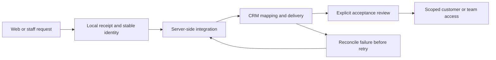

# Joseph Edwards · CRM Platforms & Automation

I administer CRM platforms and build the interfaces, mappings, and automation around them. Start with the operational problem, inspect the integration boundary, and review what has actually been validated.

**Relevant work:** Zoho CRM administration, migration and workflow delivery, CRM integration engineering, business systems ownership, and scoped implementation consulting.

   

<h2 id="rawops-suite"></h2>

RawOps Suite shows the custom business application behind the sales journey: prepare an agent, find a suitable shop, review outreach, fulfill a sample and maintain the account relationship.

  

20 October 2025: 143 detailed leads, 241 incomplete leads and 69 email chains in the historical CRM panel. These describe record quality and follow-up coverage in that capture.

**Evidence scope:** This is a custom PHP/MySQL CRM and operations platform. Zoho administration and GoHighLevel adapter work are covered by the separate cases below. RawOps preserves historical usage evidence and source; current deployment remains unvalidated.

## Continue your three-minute review

| Evidence | What to inspect | Delivery / evidence scope |
|---|---|---|
| [RawOps Suite](docs/RAWOPS-SUITE.md) | Shop discovery, lead quality, sample follow-up, store accounts, agent cards and product-aware learning. | Custom CRM source and genuine redacted historical screens; no current deployment or conversion attribution claimed. |
| [PowerPortals and Zoho widgets](https://github.com/RawPowered/PowerPortals-Showcase) | Reusable intake and customer/team workspace direction, schema review, and mapping decisions. | Commercial implementation supplied privately; public tours use fictional data. |
| [305UGC Suite](https://github.com/RawPowered/305UGC-Showcase/blob/main/docs/CRM-AND-AUTOMATION.md) | Company-specific WordPress-Zoho request delivery and customer/project access architecture. | Public website captured; full operational acceptance remains pending. |
| [Flow Fountain](https://github.com/RawPowered/flow-fountain-for-crms) | Self-hosted workflow authoring, execution review, integration grants, and adaptation points. | Original CRM adapter is GoHighLevel/LeadConnector; other adapters require implementation. |
| [Expert Solar migration history](https://github.com/RawPowered/RawPowered/blob/main/docs/EXPERT-SOLAR.md) | Salesforce-to-Zoho transition, administration ownership, and surviving configuration. | Preserved partial history of a previously functional system. |

## A closer look

Preview from the existing public portfolio; it illustrates an interface, not a new performance result. [Unpack the decisions and operating approach](docs/WALKTHROUGH.md).

## How the work connects

Conceptual review path, not a captured execution trace. [Inspect the linked evidence and verification limits](docs/EVIDENCE.md).

## Why this path

For independent clients, the reading path follows the engagement: understand the existing CRM, map the workflow, establish access and ownership, and define a reviewable acceptance result.

Independent implementation portfolio. Each engagement needs its own scope, authority, and acceptance criteria.

## Review with me

Choose one linked case. I can walk through the problem, my responsibilities, the design or integration decision, what was checked, and what still needs acceptance. Public material respects client confidentiality; private source is not implied to be available for redistribution.

Zoho experience, Salesforce history, and GoHighLevel/LeadConnector source are distinct evidence. Other CRM integrations are scoped implementation opportunities, not completed universal compatibility. No customer records, live CRM links, credentials, or private source are included.

**Available for full-time and contract work.** [Connect on LinkedIn](https://www.linkedin.com/in/josephedwardscto/).
